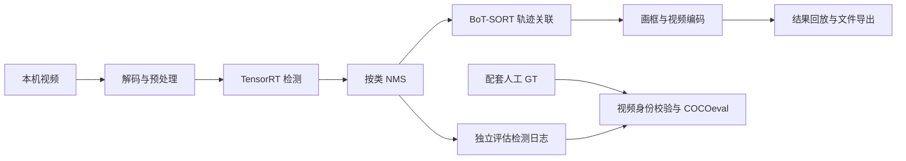

# Jetson 视频工作台

**在 NVIDIA Jetson Orin 上完成本地视频目标检测、多目标追踪、结果回放与检测精度评估。**

本项目将 YOLOv12n、TensorRT 和 BoT-SORT 集成到本机网页工作台：选择视频和运行方案，即可逐帧检测目标、关联轨迹 ID、生成带标注的 H.264 视频，并导出轨迹、检测框和耗时记录。视频有配套人工标注时，还可计算检测 AP。

项目重点是 Jetson 上的实际部署与完整视频处理，包括 FP16 引擎构建、并行流水线、视频编码、原生后处理和速度/精度取舍。当前默认关闭 ReID，运行时不依赖 PyTorch、Ultralytics 或 FastReID。

**首次使用：** 请先阅读 [GitHub 源码版部署指南](Jetson_视频工作台/docs/GitHub源码部署指南.md)。仓库包含源码和 ONNX 模型，视频素材、TensorRT 引擎、随包浏览器与离线依赖需要另外准备。

## 可以做什么

| 功能 | 说明 |
| --- | --- |
| 本机网页操作 | 选择输入视频、导出目录、检测模式和运行方案；查看进度、处理 FPS 与实时预览 |
| 两种检测模式 | COCO 80 类通用目标；无人机单类目标。无人机模式检测画面中的无人机，不代表所有航拍视频都应选此模式 |
| 多目标追踪 | BoT-SORT 按类别关联目标 ID；可选择相机运动补偿策略 |
| 多档速度与精度 | 提供 1280、640 方形输入，640×384、512×320 矩形输入，以及 512 分区增强 |
| 视频与结构化结果 | 保存 H.264 MP4、轨迹 CSV、检测 JSONL、逐阶段耗时和任务配置 |
| 检测精度评估 | 核验视频与 GT 是否对应，计算 AP50、AP50:95、分类 AP；没有有效标注时保留空白状态 |
| 任务控制 | 同时运行一个视频任务；可取消任务并保留已处理结果，取消后不发布完整视频 AP |
| 性能分析与复现 | 提供 TensorRT 构建、基准测试、原生 C/C++/CUDA 内核和浏览器验证脚本 |

适合 Jetson 视觉部署学习、视频检测与追踪演示、性能分析和方案对照。当前工作流面向本机视频文件及本机浏览器；完整推理链路以 Jetson 为目标，未提供 Windows 推理后端。

## 处理流程



解码、检测、相机特征准备和绘制/编码通过有界队列重叠执行。正常完整任务逐帧处理；降低网页预览刷新率不改变检测帧数或输出视频帧数。支持的环境优先使用 Jetson NVENC，硬件编码不可用时回退 FFmpeg/libx264。缺少原生加速库时可使用参考实现，速度会受影响。

## 运行环境

| 项目 | 目标环境 |
| --- | --- |
| 硬件 | NVIDIA Jetson Orin；报告主要来自 Orin NX 16GB |
| 系统 | Ubuntu 22.04、aarch64、JetPack 6.1/6.2 |
| Python | 3.10，复用 JetPack 的系统组件 |
| 推理 | TensorRT 10.x、JetPack 配套 CUDA；历史测试环境为 TensorRT 10.7 / CUDA 12.6 |
| 视频 | 系统 OpenCV、FFmpeg/ffprobe 与 libx264；NVENC 还需可用硬件编码器及 GStreamer 支持 |
| Python 依赖 | NumPy、SciPy、lap、Cython、cython_bbox、PyYAML、pycocotools，版本见 [requirements.txt](Jetson_视频工作台/environment/requirements.txt) |
| 可选加速构建 | GCC/G++；编译 CUDA 内核另需 nvcc |

TensorRT 引擎与设备、软件版本及输入形状有关，应在目标 Jetson 上从 ONNX 构建。源码版不自带 JetPack、CUDA 或 TensorRT 的安装环境。

## 快速开始

在已经配置好 JetPack 6 与 TensorRT 10 的 Jetson 上克隆仓库：

```bash
git clone https://github.com/ROXandSEA/jetson-video-workbench.git
cd jetson-video-workbench/Jetson_视频工作台
```

然后按 [源码部署指南](Jetson_视频工作台/docs/GitHub源码部署指南.md) 安装依赖、检查环境并构建引擎。环境准备完成后，在项目目录启动：

```bash
PYTHONNOUSERSITE=1 .venv/bin/python app/server.py --port 8765
```

在 **Jetson 本机浏览器** 打开 <http://127.0.0.1:8765>：

1. 选择模式：MOT 行人或 VisDrone 地面人车视频选「COCO 80」；无人机目标视频选「无人机」。
2. 选择自己的原始视频和导出目录，避免把已经画框的结果视频当成评测输入。
3. 按画面特点选择运行方案，点击启动；完成后回放视频并查看结果目录。
4. 如需 AP，准备输入视频同名的 `.gt.json`，或在网页指定配套标注。详见 [标注格式与评估规则](Jetson_视频工作台/docs/mAP标注格式.md)。

`启动网页.sh` 与双击入口属于完整离线包的启动流程，依赖额外的离线文件；只有 GitHub 克隆内容时，请使用上面的源码版流程。

## 运行方案怎么选

方案定义在 [`app/config.json`](Jetson_视频工作台/app/config.json)。COCO 默认使用 `quality`，无人机默认使用 `balanced`。

| 模式 / 配置键 | 输入宽×高 | 适合的情况 | 主要取舍 |
| --- | --- | --- | --- |
| COCO / `quality` | 1280×1280 | 远处目标、小目标，优先检测精度 | 计算量较大，保留相机运动补偿 |
| COCO / `balanced` | 640×640 | 通用基准与速度/精度折中 | 保留标准相机运动补偿 |
| COCO / `fast_motion` | 640×384 | 横向画面、存在镜头运动 | 轻量相机运动补偿、CUDA Graph |
| COCO / `fast_static` | 640×384 | 横向画面、固定机位 | 关闭相机运动补偿以提高吞吐 |
| COCO / `speed` | 512×320 | 固定机位、优先处理速度 | 每帧一次检测，NMS IoU 为 0.55，小目标更容易漏检 |
| COCO / `speed_detail` | 512×320，每帧 5 次推理 | 拥挤人群、小目标细节 | 全图加四个重叠分区，再统一合并与追踪；速度明显降低 |
| COCO / `int8` | 640×640 | 量化实验与复现 | 需真实视频校准；现有实验精度下降且未加速，不作为默认 |
| 无人机 / `balanced` | 640×640 | 无人机单类目标 | 独立模型与标签，不用于地面人车通用检测 |

矩形输入优先面向横向视频，不能保证所有画面都优于方形输入。`speed_detail` 虽然使用相同 512 引擎，每个源帧的推理次数是单次全图方案的五倍。

## 实测表现与数据口径

以下为 **2026-10-15 的历史实测**。设备为 Orin NX 16GB、40W，JetPack 6 / TensorRT 10.7 / CUDA 12.6；同一段 MOT20-01 预览视频共 429 帧，网页预览、追踪与 H.264 保存开启。

| COCO 方案 | 处理 FPS | 总任务耗时 | person AP50 | person AP50:95 |
| --- | ---: | ---: | ---: | ---: |
| 1280 小目标优先 | 18.32 | 27.55 秒 | 63.69% | 28.78% |
| 640 标准 | 56.00 | 10.61 秒 | 57.12% | 24.44% |
| 640×384 移动镜头 | 89.64 | 7.96 秒 | 56.33% | 24.33% |
| 640×384 固定机位 | 104.17 | 7.29 秒 | 56.33% | 24.33% |

来源：[百帧优化与 DLA 验证报告](Jetson_视频工作台/reports/百帧优化与DLA验证报告_20261015.md)。处理 FPS 包含解码、检测、追踪、绘制、日志与编码，排除模型加载、预热和最终 AP 评估；总任务耗时包含这些额外阶段。目标密度、原始分辨率、功耗/频率、后台负载及是否编译加速库都会影响结果，表中数据不代表所有设备和视频都能达到的速度。

后续 512 优化在 **MOT20-05 全 3315 帧**上的结果如下，来源为 [512 密集人群优化报告](Jetson_视频工作台/reports/512密集人群优化/512密集人群精度优化报告.md)：

| 512 方案 | person AP50 | person AP50:95 | 处理 FPS |
| --- | ---: | ---: | ---: |
| 原始全图单次检测 | 25.42% | 10.91% | 161.82 |
| 去重优化，当前 `speed` 策略 | 30.22% | 12.21% | 125.46 |
| 全图＋四分区增强 | 36.71% | 15.94% | 19.02 |

两张表使用不同视频，不能直接横向比较。512 对照中的基准脚本与网页入口也有差异，不能把所有速度变化都归因于 NMS。分区增强以更多计算换取检测细节，不代表仍能保持百帧处理。

## 如何理解精度与追踪指标

- 网页评估的是原始检测框 AP，使用独立的评估检测日志；不使用轨迹框代替检测框。
- 跟踪候选默认置信度为 0.05，评估候选默认置信度为 0.001；COCOeval 使用 101 点召回和 IoU 0.50:0.05:0.95，每帧每类 `maxDets=100`。
- MOT 视频只评估有效的 person 类；VisDrone 评估映射后的兼容类别子集。这些结果不等于完整 COCO、VisDrone 或 MOTChallenge 官方榜单成绩。
- 视频 SHA256、帧数、尺寸和类别需要与 GT 对应。缺少标注时可继续检测；标注不适用时不会生成有效 AP。
- 当前默认关闭 ReID。检测 AP 与跟踪 IDF1/MOTA 衡量不同问题，AP 变高不能直接说明身份关联更稳定。

## 输出文件

每次任务在导出目录创建独立子文件夹，默认位于 `Jetson_视频工作台/outputs/`。

| 文件 | 内容 |
| --- | --- |
| `result.mp4` | 带目标框和轨迹 ID 的 H.264 视频 |
| `tracks.csv` | 轨迹 ID、类别、目标框及置信度 |
| `detections.jsonl` | 跟踪使用的原始检测框 |
| `evaluation_detections.jsonl` | 计算检测 AP 的候选框 |
| `evaluation.json` | 评估结果或无法评估的原因 |
| `pipeline.json` | 输入/输出形状、实际编码器、运行方案、处理 FPS、帧数与耗时 |
| `timings.csv` / `output_timings.csv` | 各阶段逐帧耗时 |
| `job.json` | 任务输入、配置和最终状态 |
| `error.log` | 任务失败时的详细信息 |

详见 [结果目录说明](Jetson_视频工作台/outputs/README_结果在哪里.md)。运行结果可能包含视频内容、本机路径或任务信息，分享前需单独检查。

## 源码结构

```text
Jetson_视频工作台/
├── app/              # 本地服务、任务调度、流水线与网页界面
├── runtime/          # TensorRT/CUDA 后端、预处理、NMS 与分区增强
│   └── native/       # C/C++/CUDA 性能内核与编译说明
├── vendor/botsort/   # 适配后的 BoT-SORT 跟踪源码及许可证
├── models/           # ONNX、标签和模型/引擎构建元数据
├── environment/      # Python 依赖版本
├── tools/            # 环境检查、引擎构建、性能对照、报告与打包工具
├── tests/            # 单元测试、物理 GPU 与浏览器验证脚本
├── docs/             # 部署、代码导航、评估规则与来源说明
├── videos/           # 素材来源说明与清单；原视频和 GT 未上传
├── outputs/          # 结果目录说明；实际任务输出不纳入 Git
└── reports/          # 技术报告 Markdown 与部分指标摘要
```

详细模块职责见 [代码导航](Jetson_视频工作台/docs/代码导航.md)。运行时从 ONNX 构建 TensorRT 不需要原训练工程；`tools/export_shape.py` 等开发导出工具需要另外准备原模型工程与相应开发依赖。

## 文档与复现入口

| 阅读目标 | 文档或代码 |
| --- | --- |
| 从 GitHub 克隆后部署 | [源码版部署指南](Jetson_视频工作台/docs/GitHub源码部署指南.md) |
| 理解完整部署与提速过程 | [综合技术报告](Jetson_视频工作台/reports/技术报告/Jetson视频工作台_部署与提速技术报告.md) |
| 理解并行流水线和编码收益 | [性能优化报告](Jetson_视频工作台/reports/性能优化报告_20261015.md) |
| 了解矩形输入、CUDA Graph 与 DLA 取舍 | [百帧优化与 DLA 报告](Jetson_视频工作台/reports/百帧优化与DLA验证报告_20261015.md) |
| 了解 512 去重和分区增强 | [密集人群优化报告](Jetson_视频工作台/reports/512密集人群优化/512密集人群精度优化报告.md) |
| 准备自己的人工标注 | [mAP 标注格式](Jetson_视频工作台/docs/mAP标注格式.md) |
| 了解 INT8 的结果与复现条件 | [INT8 复现说明](Jetson_视频工作台/docs/INT8如何复现.md) |
| 编译原生性能内核 | [原生内核说明](Jetson_视频工作台/runtime/native/README.md) |
| 选择和核对视频来源 | [素材说明](Jetson_视频工作台/videos/README_素材选择.md) |

历史文档中的 PDF、Word、截图和部分原始实验数据属于本机离线包，未随源码仓库发布。首页优先链接已纳入 Git 的 Markdown 文档；历史报告中的附件链接可能需要完整离线包才能打开。

## 仓库范围与隐私

仓库保留源码、网页资源、ONNX 模型、模型元数据、配置、测试及文本报告。完整离线运行包还包含视频、GT、浏览器、wheel、引擎和编译入口，这些文件仍保留在本地，不能仅通过克隆仓库取得。

根目录 [`.gitignore`](.gitignore) 排除 API 密钥、环境文件、凭据、私钥、运行状态、日志、历史输出及包含本机信息的原始记录。初次发布前已对实际上传内容执行 Gitleaks 和本机路径检查。后续新增内容仍需检查，尤其不要用 `git add -f` 绕过规则上传私有配置或数据。

## 来源与许可证

YOLOv12 与 BoT-SORT 来自原移交项目，模型由已有权重导出；本仓库不声称重新训练了这些模型。上游 AGPL-3.0 许可证保留于 [LICENSE-上游.txt](Jetson_视频工作台/LICENSE-上游.txt) 与 [BoT-SORT LICENSE](Jetson_视频工作台/vendor/botsort/LICENSE)。第三方代码、字体、模型及数据素材的来源和授权说明见 [来源与许可证](Jetson_视频工作台/docs/来源与许可证.md)。使用和再分发时请保留相关署名与许可证，并遵守各数据集条款。
